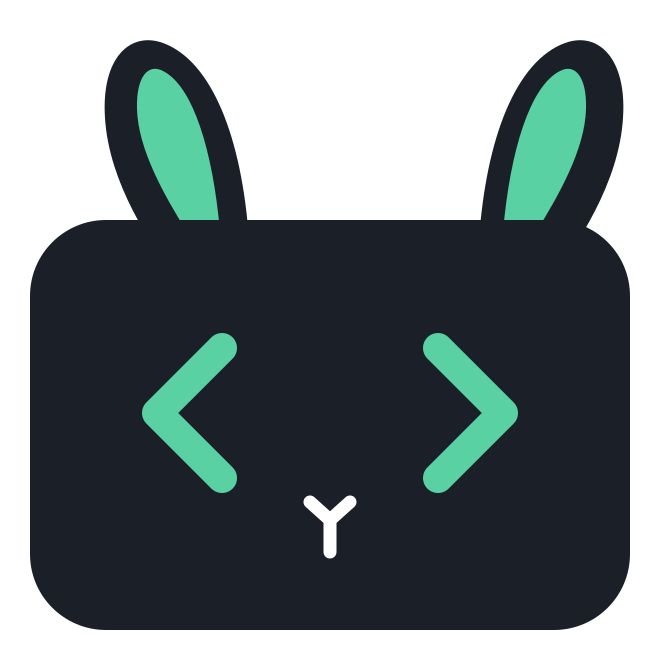
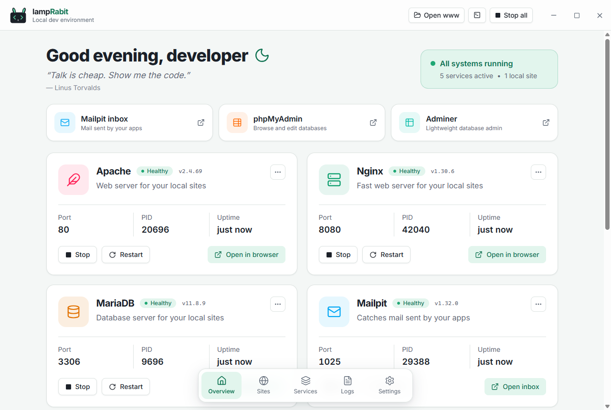
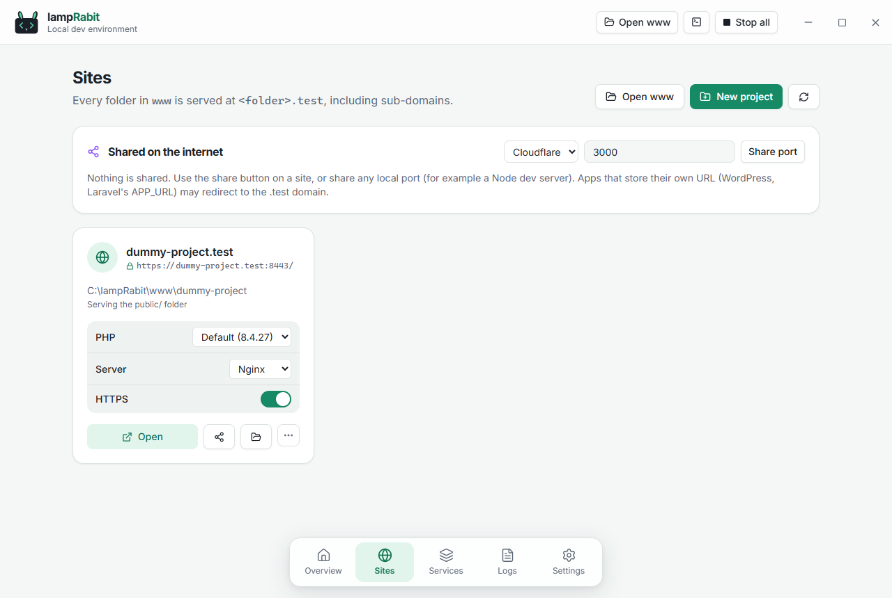
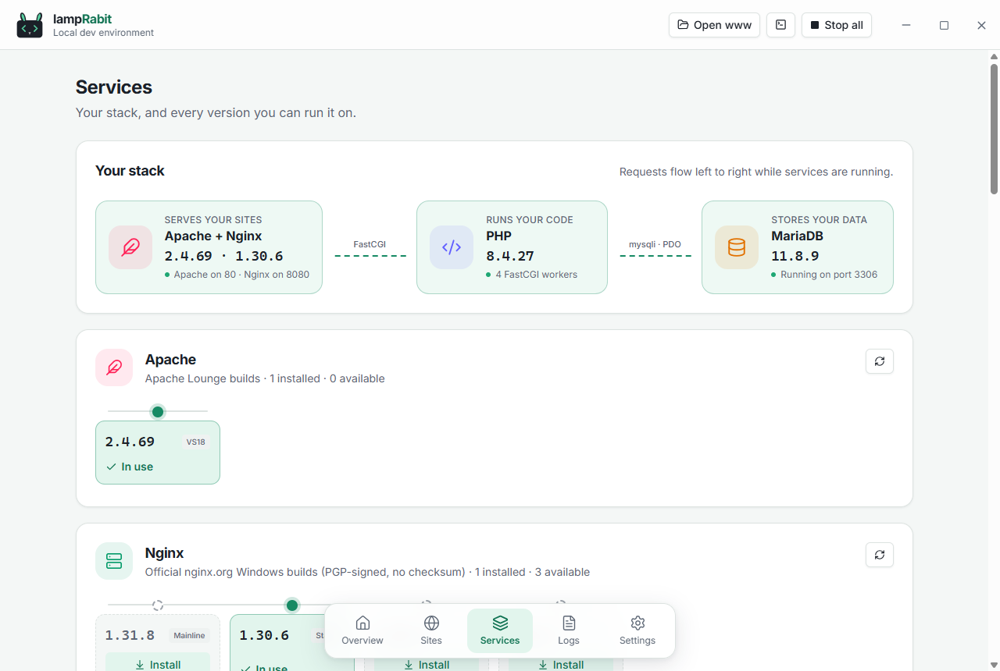

<div align="center">



# LampRabit

**A fast, friendly local development environment for PHP and Node.js.** Ready on Windows and Linux; macOS in preview.

Apache or Nginx, PHP, MariaDB, MySQL, Redis and the tools around them, with one click. Every folder in `www` becomes `https://<folder>.test`, whether it's a PHP site or a Node.js dev server.

[](https://github.com/Shivam-SV/LampRabit/releases/latest)
[](https://github.com/Shivam-SV/LampRabit/actions/workflows/ci.yml)
[](LICENSE)
-1b2028)

[**Website**](https://shivam-sv.github.io/LampRabitWebsite/) · [**Download**](https://github.com/Shivam-SV/LampRabit/releases/latest) · [Features](docs/website/features.md) · [Installation](docs/website/installation.md) · [FAQ](docs/website/faq.md) · [Documentation](#documentation)



</div>

## Why LampRabit

If you've used XAMPP or Laragon, you know the idea: a local web stack you don't have to assemble by hand. LampRabit keeps that simplicity and adds what modern work needs: several PHP versions side by side, a PHP version per site, HTTPS that just works, Nginx next to Apache, Node.js projects served at their own domain, and a clean, modern interface.

## Features

**Your stack**
- **One-click services.** Apache and/or Nginx, PHP, MariaDB, MySQL, Mailpit, Redis and Memcached. Runtimes download on demand, checksum-verified, and you can keep several versions installed.
- **Stack profiles.** Save the services a kind of project needs ("Laravel", "WordPress") and start just those; Restart once everything's up.
- **Tools included.** phpMyAdmin, Adminer, phpRedisAdmin and a Mailpit inbox that catches every email your apps send.
- **PHP extensions.** Switch bundled extensions on or off and install extras like Xdebug and Redis per PHP version.

**Your projects**
- **Sites without configuration.** `www/my-app` is served at `my-app.test`, with `public/` detection, sub-domains and the hosts file kept in sync.
- **HTTPS by default.** A local certificate authority issues trusted certificates for every site; turn it off per site if you like.
- **Node.js projects.** Vite, Next.js, Nuxt, Astro, Express or NestJS on the Node version you choose (from NVM, `.nvmrc` respected) with npm, pnpm, Yarn or Bun. Start the dev server from LampRabit, or run it yourself in a terminal: the domain follows whatever the project listens on, and falls back to its files when it stops.
- **New projects in seconds.** Templates for Laravel, Symfony, WordPress, Drupal, CakePHP, CodeIgniter, Statamic, Magento and the Node frameworks above, asking the same questions their own installers do (TypeScript, linter, router, modules…), optionally with a fresh database. Write your own in YAML: see [Project templates](docs/templates.md).
- **Project commands.** Run artisan, Composer and package.json scripts (and Symfony, Drupal, Magento, Statamic, CakePHP and CodeIgniter commands) from the project, with the output right there and in Logs.
- **Everything about a project at a glance.** Framework and version, PHP or Node version and what the project requires, whether dependencies are installed, `.env` settings, database and git state.
- **Per-site choices.** PHP version, web server and HTTPS for each site. In the terminal, `php` and `composer` follow the site's PHP version too.
- **Share a site.** Public URLs through Cloudflare Tunnel (no account needed) or ngrok.

**Day to day**
- **Command line ready.** Put `php`, `composer`, `mysql`, `redis-cli` and friends on your PATH with one switch.
- **Know what's going on.** Live logs from services and projects with search (regex too), severity and source filters, and export; health checks; port-conflict detection that names the program in the way; and a one-click diagnostics report.
- **Lives in your tray,** starts with your computer if you want, follows your light or dark theme, has keyboard shortcuts for everything (`?`), and updates itself.

<table>
  <tr>
    <td></td>
    <td></td>
  </tr>
  <tr>
    <td align="center">Sites: PHP, server and HTTPS per site</td>
    <td align="center">Services: your stack and every version</td>
  </tr>
</table>

## Download

Get the latest version from the [**Releases page**](https://github.com/Shivam-SV/LampRabit/releases/latest):

| Platform | File | Status |
|---|---|---|
| Windows 10/11 (64-bit) | `…_x64-setup.exe` (recommended) or `…_x64_en-US.msi` | Ready |
| macOS, Apple Silicon | `…_aarch64.dmg` | Preview |
| macOS, Intel | `…_x64.dmg` | Preview |
| Linux, Debian/Ubuntu | `…_amd64.deb` | Ready |
| Linux, other distributions | `…_amd64.AppImage` | Ready |

### Platform support

On **Windows and Linux**, everything above works today. Linux gets LampRabit's own builds of Apache, Nginx, PHP, Redis and Memcached, so you choose versions the same way as on Windows. On **macOS** the app runs and the same builds are being added (preview); MariaDB and MySQL aren't downloadable there yet.

| Runtime | Windows | macOS | Linux |
|---|---|---|---|
| Apache, Nginx, PHP | ✅ | Preview | ✅ |
| MariaDB, MySQL | ✅ | Coming soon | ✅ |
| Composer | ✅ | ✅ | ✅ |
| phpMyAdmin, Adminer | ✅ | With Apache and PHP | With Apache and PHP |
| Redis, with redis-cli | ✅ (community redis-windows build) | ✅ | ✅ |
| Mailpit, phpRedisAdmin, Cloudflare/ngrok tunnels | ✅ | ✅ | ✅ |
| Memcached | ✅ (nono303's build) | Preview | ✅ |
| Node.js projects (through [NVM](https://github.com/coreybutler/nvm-windows) / [nvm](https://github.com/nvm-sh/nvm)) | ✅ | ✅ | ✅ |

> [!NOTE]
> Builds aren't code-signed yet. On Windows, click **More info → Run anyway**. On macOS, open **System Settings → Privacy & Security** and click **Open Anyway**. Full steps are in the [installation guide](docs/website/installation.md).

## Quick start

1. Install and open LampRabit.
2. Go to **Services** and install Apache (or Nginx), PHP and MariaDB. Pick any versions you like.
3. Click **Start all**.
4. Put a project in the `www` folder (`C:\lampRabit\www` on Windows, `~/lampRabit/www` elsewhere), or click **New project** on the Sites page.
5. Open `https://<folder>.test`. For a Node.js project, press **Start** on its Sites page (or run `npm run dev` yourself) first.

The database user is `root` with no password, like XAMPP and Laragon.

## Coming from XAMPP or Laragon?

Step-by-step guides for moving your sites and databases:

- [Migrate from XAMPP](docs/website/migrate-from-xampp.md)
- [Migrate from Laragon](docs/website/migrate-from-laragon.md)

## Documentation

**Using LampRabit**
- [Features](docs/website/features.md): everything LampRabit does, page by page
- [Installation](docs/website/installation.md): installers, first run, and getting past unsigned-build warnings
- [FAQ](docs/website/faq.md): common questions and fixes
- [Project templates](docs/templates.md): the YAML format for your own New project templates (variables, steps, serving, commands)
- [Migrate from XAMPP](docs/website/migrate-from-xampp.md) and [from Laragon](docs/website/migrate-from-laragon.md)

**Working on LampRabit**
- [Contributing](CONTRIBUTING.md): setup, checks and conventions
- [Releasing](RELEASING.md): versions, the release workflow and LampRabit's own runtime builds
- [Roadmap](PLAN.md): what's done and what's next
- [Security policy](SECURITY.md): reporting a vulnerability

## Building from source

You need Node.js 22+, Rust (stable) and the [Tauri prerequisites](https://v2.tauri.app/start/prerequisites/) for your OS.

```bash
git clone https://github.com/Shivam-SV/LampRabit.git
cd LampRabit
npm install
npm run tauri dev     # run in development
npm run tauri build   # build installers
```

LampRabit is built with [Tauri 2](https://v2.tauri.app/) (Rust) and React + TypeScript.

## Contributing

Bug reports, ideas and pull requests are welcome. Read [CONTRIBUTING.md](CONTRIBUTING.md) to get started, and report security issues privately as described in [SECURITY.md](SECURITY.md).

## License

[MIT](LICENSE)
